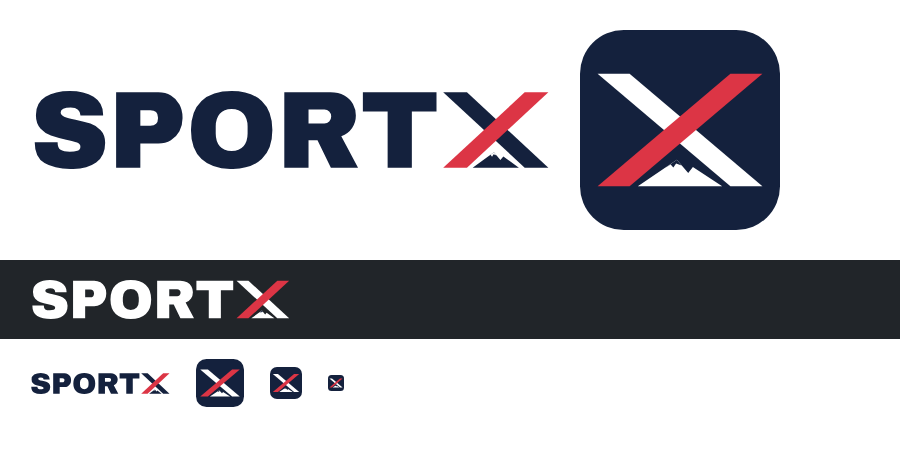

# Marca SportX Chile — logo "Cordillera"

- **Idea:** la X de SportX se forma con un trazo azul y uno rojo ascendente; en su abertura inferior aparece la cordillera de los Andes con nieve.
- **Colores:** azul noche `#14213D` · rojo `#DC3545` (el mismo rojo de los botones) · blanco `#FFFFFF`.
- **Tipografía:** "SPORT" en Archivo Black (licencia SIL OFL 1.1), convertida a trazos vectoriales: no depende de fuentes instaladas.

| Archivo (`frontend/public/brand/`) | Uso |
|---|---|
| `sportx-logo.svg` | Logo horizontal sobre fondos claros (barra superior) |
| `sportx-logo-blanco.svg` | Logo sobre fondos oscuros (pie de página) |
| `sportx-icono.svg` | Ícono / favicon |
| `sportx-icono-180.png`, `-192.png`, `-512.png` | Ícono para iOS/Android y redes |

**Uso correcto:** no estirar, no cambiar colores, no agregar sombras ni contornos. Espacio libre mínimo alrededor = altura de la "X" × 0,25. Tamaño mínimo del logo horizontal: 100 px de ancho; del ícono: 16 px.

Los SVG se generan con `generar-logo.py` (requiere `fonttools` y el paquete `@fontsource/archivo-black`).
